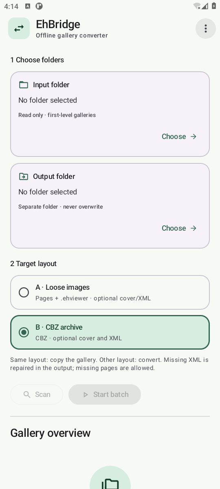
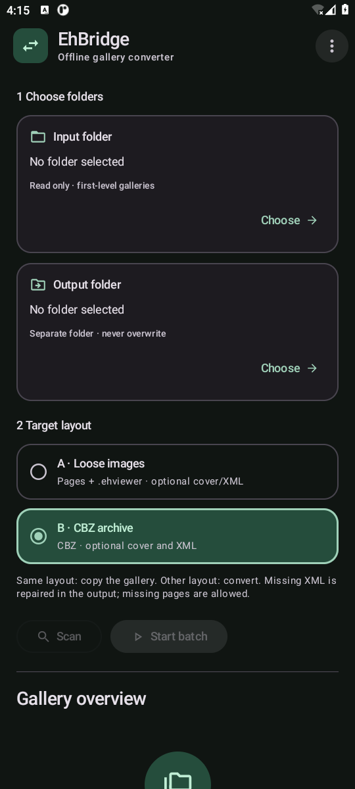
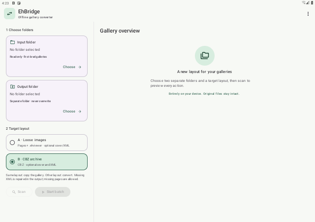

# EhBridge

[简体中文](#简体中文) · [English](#english) · [Releases](https://github.com/Hycnyl/EhBridge/releases)

**1.1.0** · Android 8.0+ · 简体中文 / English · GPL-3.0-only

离线 Android 画廊批量转换工具，在「文件夹＋散图」与「文件夹＋CBZ」之间转换，保留原始页面文件，源目录只读。

An offline Android batch converter for loose-image and CBZ gallery folders. Original page files are preserved and source folders remain read-only.

## 界面预览 / Screenshots

| 常规设备 · 亮色 / Phone · Light | 常规设备 · 暗色 / Phone · Dark |
| --- | --- |
| <a href="docs/screenshots/phone-light.png"></a> | <a href="docs/screenshots/phone-dark.png"></a> |

**大屏双栏 / Tablet, two-column layout**

[](docs/screenshots/tablet-light.png)

截图来自 1.1.0 发布包在 Android 模拟器上的实际初始界面，不含真实画廊。点击图片可查看原图。

Captured from the 1.1.0 release APK's initial interface on an Android emulator, without real galleries. Click an image for full size.

## 简体中文

### 功能

- **散图与 CBZ 双向转换**：A→B 打包页面并丢弃原 `.ehviewer`；B→A 解包页面并生成真正的 CBOR SpiderInfo。输入与目标格式相同时，按原样复制。
- **可靠读取合法 CBZ**：修复 SAF 文件描述符可定位但无法重新打开时的读取问题；普通读写失败与不安全 ZIP 分别报告，避免把合法画廊误判为损坏。
- **宽容处理元数据缺失**：外部 `ComicInfo.xml`、`thumb / thumb.*` 和 CBZ 内部 XML 均可缺失；缺少外部 XML 或封面时显示非阻断提示。缺失的外部 XML 在输出中优先从 CBZ 内部恢复，否则根据文件夹标题、GID 和页号生成。既有 XML 保留原始字节，不生成假封面或猜测 token。
- **画廊总览筛选**：「全部／散图／CBZ／无效」可点击切换，扫描完成默认显示全部；点击画廊查看计划、错误和提示。
- **长列表快速定位**：快速滑动时显示可拖动的 Material 3 滚动滑块，停止后自动淡出；慢速滚动不触发显示。
- **分类提示开关**：菜单中的「非阻断提示」打开设置对话框，可分别控制每种提示。错误始终显示，导出的报告保留全部提示。
- **Android 原生体验**：Material 3、亮色／暗色／跟随系统、Android 12+ 动态配色、宽屏双栏，以及 Android 13+ 受支持桌面上的动态主题图标。
- **离线与安全输出**：源文件不修改，已有输出不覆盖；提供扫描预览、批处理进度、取消、前台通知和文字报告导出。

### 安装

从 [Releases](https://github.com/Hycnyl/EhBridge/releases) 选择对应版本的 `EhBridge-1.1.0-universal.apk`。最低 Android 8.0（API 26），一个 APK 覆盖 arm64-v8a、armeabi-v7a、x86、x86_64，无需按 CPU 架构选择。

本版应用 ID 为 `com.hycnyl.ehbridge`，版本号 `1.1.0`，`versionCode = 2`。

### 使用

1. 通过系统文件选择器，从同一存储提供程序选择输入根目录和独立的输出根目录；两者不能相同或互相包含。
2. 选择目标格式：A「散图」或 B「CBZ」。画廊文件夹应直接位于输入根目录下。
3. 点击「扫描」，检查总览、各画廊的处理计划及提示。筛选只影响显示，批处理仍按完整扫描计划执行。
4. 点击「开始处理」。同格式复制，异格式转换；目标已有同名对象时跳过，不覆盖或合并。
5. 可随时取消；已完成画廊保留，当前未提交输出尽量清理。中断后重新扫描即可重试。

右上角菜单可切换语言和外观、设置分类提示、导出报告，以及查看帮助与兼容性。通知权限用于后台进度显示，拒绝该权限不会阻止本地转换。

### 支持的目录结构

画廊文件夹命名为 `正整数GID-标题`，例如：

```text
A：文件夹＋散图                 B：文件夹＋CBZ
10001-title/                   10001-title/
├── .ehviewer                  ├── 10001.cbz
├── 00000001.jpg               ├── ComicInfo.xml  [可选]
├── 00000003.png               └── thumb.webp     [可选]
├── ComicInfo.xml  [可选]
└── thumb.webp     [可选]

10001.cbz 的 ZIP 根目录：
├── 00000001.jpg
├── 00000003.png
└── ComicInfo.xml  [可选]
```

1.1.0 的散图画廊需要 `.ehviewer` 和至少一个数字页文件。CBZ 名称须与文件夹的 GID 一致，页面位于 ZIP 根目录。页文件名由至少 8 位数字和非空扩展名组成，页号范围 1–100000；允许缺页、非连续页号和不同扩展名，不解码或转码图片。封面可命名为 `thumb` 或 `thumb.*`，不限定 WebP。

XML 修复只写入输出目录；同格式复制也会补齐缺失的外部 XML。文件夹标题按现有名称保留，不猜测已经被替换或截断的字符。

### 数据与兼容性

所有文件操作通过 Android 存储访问框架（SAF），应用不申请网络、Root 或全盘文件管理权限。ZIP 检查路径、重复条目、加密、压缩方式和大小，解包时核验页面大小与 CRC；不支持的结构会跳过并说明原因。无法直接随机读取的 CBZ 需要足够的应用缓存空间建立临时副本，用完后清理。

B→A 从与 GID 匹配的 ComicInfo 画廊 URL 中提取 token，无法提取时写入 `null` 并提示；不恢复页 token 或阅读位置。生成文件不保证在所有 EhViewer 分支中恢复下载列表，目标客户端导入兼容性尚未独立验证。强制停止或存储断开可能留下临时输出目录；本工具不维护可跨进程恢复的任务队列。

### 从源码构建

准备 JDK 21、Android SDK 36、Build Tools 35.0.0 和 Platform Tools。项目使用 Gradle 8.13、AGP 8.13.2、Kotlin 2.2.21、Compose BOM 2025.10.01，JVM 目标为 17。通过 `ANDROID_HOME` 或本机 `local.properties` 指定 SDK 路径。

```sh
sdkmanager 'platforms;android-36' 'build-tools;35.0.0' 'platform-tools'
./gradlew :app:assembleDebug
./gradlew :app:testDebugUnitTest
./gradlew :app:assembleRelease
```

Windows 使用 `gradlew.bat`。未配置私有签名时，release 产物未签名；安装测试可使用 debug。自行签名可在被 Git 忽略的 `signing.properties` 中配置 `storeFile`、`storePassword`、`keyAlias` 和 `keyPassword`。请使用自己的密钥，不要提交任何签名材料。

本版验证范围和结果见 [验收记录](docs/Acceptance.md)。仪器测试会修改显示配置并创建大量合成文件，仅适合专用测试设备。

### 作者与协议

作者：[Hycnyl](https://github.com/Hycnyl) · 项目：[Hycnyl/EhBridge](https://github.com/Hycnyl/EhBridge)

Copyright (C) 2026 Hycnyl。EhBridge 原创代码采用 **GNU GPL v3.0 only（GPL-3.0-only）**，完整协议见 [LICENSE](LICENSE)。第三方许可见 [THIRD_PARTY_NOTICES.md](THIRD_PARTY_NOTICES.md)。感谢 EhViewer 及相关分支的格式参考，以及 AndroidX、Jetpack Compose、Kotlin、kotlinx 和 Gradle；本项目是独立工具。

## English

### Features

- **Loose-image ↔ CBZ conversion:** A→B packs pages and discards the original `.ehviewer`; B→A extracts pages and creates actual CBOR SpiderInfo. Matching layouts are copied without conversion.
- **Reliable access to valid CBZ archives:** the SAF reader handles seekable descriptors that cannot be reopened. Ordinary read/write errors are distinguished from unsafe ZIP structures, preventing valid galleries from being mislabeled as corrupt.
- **Optional metadata and output repair:** external `ComicInfo.xml`, `thumb / thumb.*` and inner CBZ XML may be absent. Missing external XML or covers produce nonblocking warnings. Missing external XML is restored in the output from the archive or generated from the folder title, GID and page indices. Existing XML bytes are preserved; covers and tokens are never fabricated.
- **Overview filters:** choose All, Loose, CBZ or Invalid. Scans initially show all galleries; tap a gallery for its plan, errors and warnings.
- **Fast navigation:** a draggable Material 3 scroll thumb appears during fast scrolling and fades after inactivity. Slow scrolling does not reveal it.
- **Per-type warning controls:** the Nonblocking warnings menu opens individual switches. Errors remain visible and exported reports retain every warning.
- **Native Android interface:** Material 3, light/dark/system themes, dynamic colors on Android 12+, two columns on wide screens and themed app icons on supported Android 13+ launchers.
- **Offline, safe output:** read-only sources, no overwriting, scan previews, batch progress, cancellation, foreground notifications and text report export.

### Installation and use

Select `EhBridge-1.1.0-universal.apk` for this version from [Releases](https://github.com/Hycnyl/EhBridge/releases). Android 8.0 / API 26 or later is required. One APK covers arm64-v8a, armeabi-v7a, x86 and x86_64, with no architecture selection. The application ID is `com.hycnyl.ehbridge`; the version is `1.1.0`, with `versionCode = 2`.

1. Choose separate input and output roots with the system picker. Use the same storage provider; the roots must neither coincide nor contain one another.
2. Select target layout A (Loose) or B (CBZ). Each gallery must be a direct child of the input root.
3. Scan and review the complete plan and warnings. Overview filters only affect display; processing still uses the full scan plan.
4. Start the batch. Matching layouts are copied; other layouts are converted. Existing output names are skipped without overwriting or merging.
5. Cancel at any time. Completed galleries remain; uncommitted output is cleaned where possible. Rescan to retry after interruption.

The overflow menu provides language, appearance, warning controls, report export, and help and compatibility information. Notification permission enables background progress notifications; declining it does not prevent local conversion.

### Gallery formats

Name each folder `positive-GID-title`. The directory example above shows both layouts; entries marked `[可选]` are optional. In 1.1.0, loose galleries require `.ehviewer` and at least one numbered page file. CBZ galleries contain `GID.cbz` with flat page entries at the ZIP root. Page filenames use at least eight digits followed by a nonempty extension, with page indices from 1 to 100000. Gaps, nonconsecutive indices and different extensions are allowed. Images are not decoded or transcoded. Covers may be named `thumb` or `thumb.*`; WebP is not required.

XML repair only writes to the output. Same-layout copies also repair missing external XML. Existing folder titles are retained without guessing characters that were sanitized or truncated.

### Data handling and compatibility

All file operations use Android's Storage Access Framework. The app requests no network, Root or all-files access. ZIP path, duplicate, encryption, compression-method and size checks are enforced; extraction also verifies page sizes and CRCs. Unsupported structures are skipped with an explanation. Archives that cannot be read randomly require enough private cache space for a temporary copy, which is cleaned afterward.

B→A obtains the gallery token from a ComicInfo URL matching the GID, or writes `null` with a warning. Page tokens and reading positions are not restored. Download-list restoration across EhViewer forks is not guaranteed; target-client import compatibility has not been independently verified. Forced termination or disconnected storage can leave temporary output. There is no persistent task queue that resumes across process restarts.

### Building and verification

Use JDK 21, Android SDK 36, Build Tools 35.0.0 and Platform Tools. The project pins Gradle 8.13, AGP 8.13.2, Kotlin 2.2.21 and Compose BOM 2025.10.01, targeting JVM bytecode 17. Configure `ANDROID_HOME` or your local SDK path in `local.properties`, then run the build commands above. On Windows, use `gradlew.bat`.

Release output is unsigned unless private signing is configured; debug builds can be installed for testing. To sign your own build, set `storeFile`, `storePassword`, `keyAlias` and `keyPassword` in the Git-ignored `signing.properties`. Use your own key and keep signing material private.

See [Acceptance.md](docs/Acceptance.md) for this version's verification scope and results. Instrumentation tests change display settings and create many synthetic files, so use a dedicated test device.

### Author and license

Author: [Hycnyl](https://github.com/Hycnyl) · Project: [Hycnyl/EhBridge](https://github.com/Hycnyl/EhBridge)

Copyright (C) 2026 Hycnyl. Original EhBridge code is licensed under **GNU GPL v3.0 only (GPL-3.0-only)**; see [LICENSE](LICENSE). Third-party notices are in [THIRD_PARTY_NOTICES.md](THIRD_PARTY_NOTICES.md). Thanks to EhViewer and related forks for format references, and to AndroidX, Jetpack Compose, Kotlin, kotlinx and Gradle. EhBridge is an independent project.
